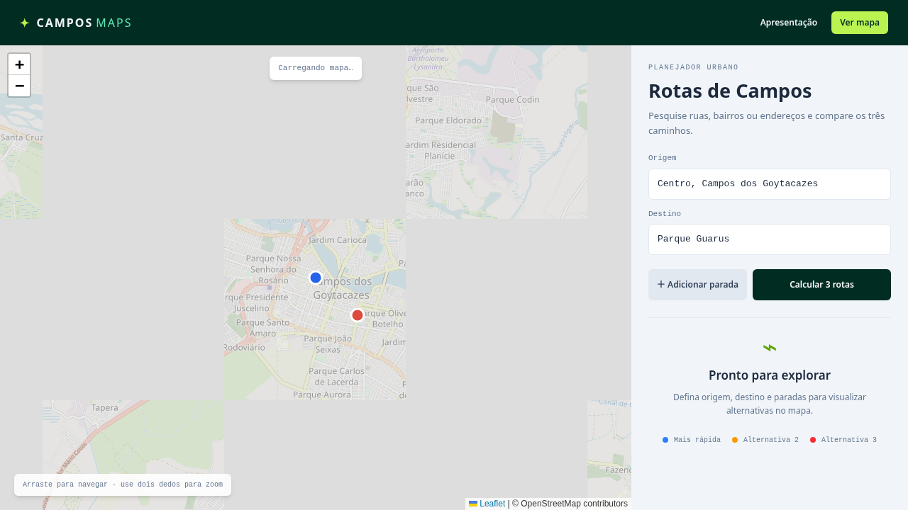
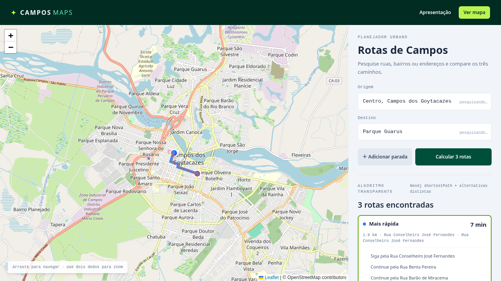

# Campos Maps

Aplicação acadêmica da disciplina de Banco de Dados NoSQL que transforma a malha viária real de Campos dos Goytacazes em um grafo Neo4j. Permite pesquisar endereços, adicionar paradas e comparar até três rotas distintas no mapa.

Não há usuários, autenticação ou dados pessoais.

## Demonstração

- Início: contexto do trabalho.
- Apresentação: arquitetura, pipeline OSM, Neo4j, Cypher e Dijkstra.
- Mapa: pesquisa de endereços e cálculo das rotas.

Os screenshots são gerados pelo Playwright contra a aplicação em execução. O mapa usa tiles reais do OpenStreetMap.

## Stack

Frontend: React 18, TypeScript, Vite, Leaflet, Tailwind CSS, Zod, ESLint, Vitest e Playwright.

Backend: Java 21, Spring Boot, Spring Data Neo4j e Maven.

Infraestrutura: Nix Flake, Docker Compose, Neo4j Community e Chromium para os testes.

Portas utilizadas: frontend 43783, backend 43784, Neo4j Bolt 7687 e Neo4j Browser 7474.

## Execução

~~~
nix develop
docker compose up -d
npm install --prefix frontend
./scripts/download-osm.sh
./scripts/import-osm.sh
~~~

Em terminais separados:

~~~
cd backend && mvn spring-boot:run
cd frontend && npm run dev
~~~

Acesse:

- http://localhost:43783
- http://localhost:43783/#/presentation
- http://localhost:43783/#/map
- http://localhost:43784
- http://localhost:7474

Para expor a aplicação completa pelo domínio público configurado:

~~~
ngrok http 43783
~~~

A URL pública configurada é https://jaunt-paradox-obsessive.ngrok-free.dev/.

O frontend usa chamadas relativas em /api. O Vite encaminha essas chamadas
para o backend local em 43784, portanto o navegador não tenta acessar
localhost e frontend, busca de endereços e cálculo de rotas funcionam pelo
mesmo domínio do ngrok.

## Dados reais

O dataset é OpenStreetMap, sob licença ODbL, obtido pelo extrato integral do estado do Rio de Janeiro:

https://download.openstreetmap.fr/extracts/south-america/brazil/southeast/

O pipeline executa:

1. Download do PBF do estado do RJ.
2. Validação do MD5.
3. Recorte geográfico de Campos com osmium.
4. Filtro de vias com a tag highway.
5. Exportação para GeoJSON.
6. Importação em lotes no Neo4j.

Área recortada:

~~~
-41.45,-21.90,-41.18,-21.62
~~~

Os arquivos grandes ficam ignorados pelo Git e podem ser reconstruídos pelos scripts.

## Modelagem Neo4j

A malha viária usa um property graph:

~~~
(:RoadNode { id, lat, lon })
       -[:ROAD {
          osm_id,
          segment,
          meters,
          name,
          highway
        }]->
(:RoadNode { id, lat, lon })
~~~

Cada vértice OSM vira um RoadNode. Cada par consecutivo de coordenadas vira uma relação ROAD. As relações guardam meters, name, highway, osm_id e segment.

Vias de mão dupla recebem a relação inversa. Vias de mão única preservam o sentido permitido. Uma constraint de unicidade protege RoadNode.id.

A importação usa UNWIND, MERGE e lotes de 1.000 registros:

~~~
UNWIND $rows AS row // percorre cada segmento do lote
MERGE (a:RoadNode {id: row.ak}) // cria ou reutiliza o nó inicial
  SET a.lat = row.alat, a.lon = row.alon // salva as coordenadas do início
MERGE (b:RoadNode {id: row.bk}) // cria ou reutiliza o nó final
MERGE (a)-[r:ROAD { // cria ou reutiliza a conexão
  osm_id: row.osm, // identificador original do OSM
  segment: row.segment // identificador do segmento
}]->(b) // mantém o sentido de a para b
SET r.meters = row.meters, // peso em metros
    r.name = row.name, // nome da rua
    r.highway = row.highway // tipo da via
~~~

## Cálculo das rotas

Para cada trecho origem, parada e destino, o backend:

1. Localiza o RoadNode mais próximo.
2. Executa shortestPath no grafo.
3. Soma ROAD.meters.
4. Extrai geometria e passos.
5. Bloqueia relações da rota-base para buscar alternativas.
6. Deduplica geometrias e retorna no máximo três caminhos distintos.

Consulta principal:

~~~
MATCH path = shortestPath((a)-[:ROAD*..120]->(b))
WHERE all(r IN relationships(path)
  WHERE NOT elementId(r) IN $blockedRelationshipIds)
WITH path, reduce(total = 0.0, r IN relationships(path) |
  total + r.meters) AS meters
RETURN nodes(path), relationships(path), meters
~~~

Se não existirem três caminhos realmente diferentes, a API retorna menos rotas, nunca duplicatas.

## Contratos e organização

Os schemas Zod são a fonte única dos tipos TypeScript. Eles validam coordenadas, requests, responses, endereços, limites de paradas e geometrias distintas.

~~~
frontend/src/
├── components/    componentes visuais
├── context/       origem, destino e paradas
├── hooks/         busca, rotas e tiles
├── pages/         início, apresentação e mapa
├── services/      comunicação HTTP
├── types/         schemas Zod e tipos inferidos
└── App.tsx        navegação por hash
~~~

O backend segue:

~~~
controller / dto / service / repository
entity / mapper / analytics / exception
~~~

A página é dona do resultado selecionado. Hooks e services concentram efeitos e comunicação. O MapView apenas renderiza o mapa.

## Qualidade

ESLint está configurado com TypeScript recomendado, React Hooks, indentação de 2 espaços, aspas simples, ponto e vírgula, variáveis sem uso proibidas e limite de 140 colunas. O Prettier usa aspas simples.

Tailwind é mobile-first, com alvos de toque de 44 px, layout responsivo e suporte a zoom por pinça.

~~~bash
cd frontend
npm run lint
npm test
npm run build
nix develop -c npm run test:e2e
~~~

~~~bash
cd backend
mvn test
~~~

Os testes cobrem contratos Zod, rotas únicas, tiles dos níveis 13 a 19, gesto de pinça, breakpoints base/sm/md/lg/xl/2xl, conexões do grafo de Dijkstra e screenshots.

## Limitações

- Neo4j Community não inclui todos os recursos do Graph Data Science; as alternativas usam shortestPath nativo e bloqueio de relações.
- Tiles dependem dos servidores do OpenStreetMap.
- O geocoding usa Nominatim e deve respeitar sua política de uso.
- O exemplo de rua na apresentação é didático; o banco é construído pelo dataset OSM real.

## Licença dos dados

Os dados do OpenStreetMap são distribuídos sob a Open Database License (ODbL). Consulte os termos antes de redistribuir dados derivados.
